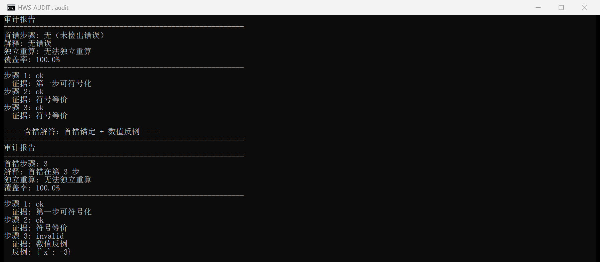
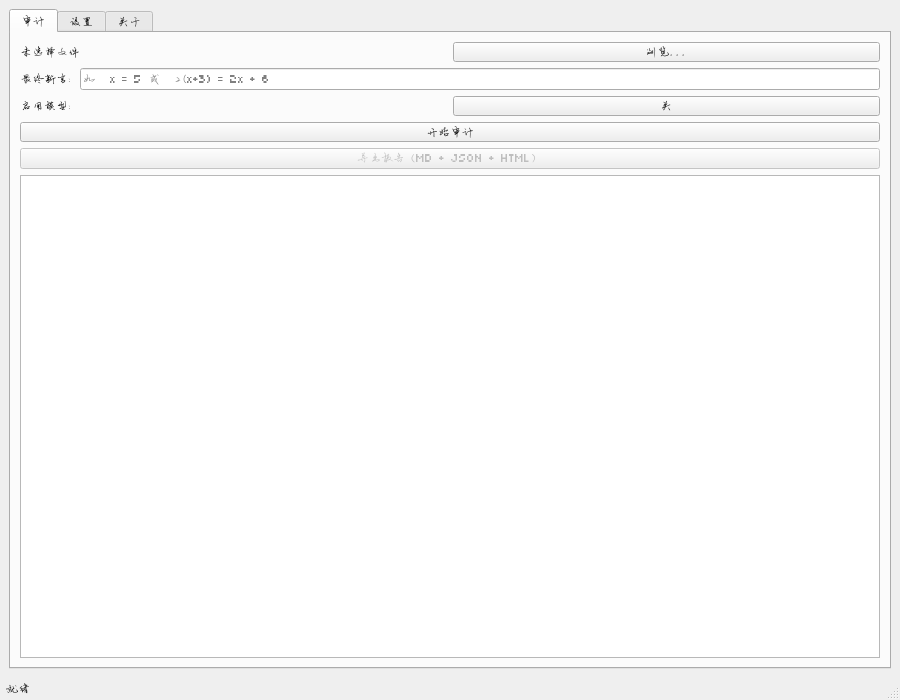

# HWS 难题解答步骤级审计与错误定位器 — 输入一份数学解答，定位第一处出错的那一步

[](https://github.com/yuluo554/hard-math-solution-auditor/actions/workflows/ci.yml)




**给题库质检、教研与阅卷复核**：不是判「答案对不对」，而是**逐步**验证每一行，
指出**第一处出错的那一步**并给出反例 —— 纯确定性、零模型依赖、可离线复跑。

当前版本 **v0.2.0**：[Release](https://github.com/yuluo554/hard-math-solution-auditor/releases/tag/v0.2.0)
（Windows 64 位免安装 CLI / GUI 双 exe + `sha256sums.txt` + 源码包 + 演示 GIF）。

## 给谁用

- 题库与教辅质检：批量筛出「解析里哪一步开始推错」，而不是只标"答案错"。
- 教研与命题：核对自己写的解题步骤链，验证结论不被中间步骤的等价性瑕疵污染。
- 阅卷复核：把一个**断言**（如 `x = 2 or x = 3`）与整条推导链对账，定位到行。

## 30 秒跑起来

```bash
pip install -e ".[dev]"                     # 要求 Python ≥ 3.8（3.8 与 3.12 都在 CI 矩阵里）
hws-audit selftest                          # 冻结态自检：数据可达 + 真值台账未漂移 + 引擎自洽
hws-audit benchmark --run                   # 内置基准：9 类错误类型覆盖度 + 误报率 + 探活
hws-audit audit --input data/samples/dirty_solution.txt
```

第三行的预期输出（实测）：

```
首错步骤: 3
解释: 首错在第 3 步
覆盖率: 100.0%
步骤 1: ok  证据: 第一步可符号化
步骤 2: ok  证据: 符号等价
步骤 3: invalid  证据: 数值反例  反例: {'x': -3}
```

干净解答（`data/samples/clean_solution.txt`）永远输出「首错步骤: 无（未检出错误）」——
**误报率 0 是硬门，干净解永不被标记为错误**。

## 它解决什么问题

现有工具要么只判最终答案，要么把整份解答丢给模型「感觉一下哪里不对」。
本题做的是**确定性判定链**：步骤切分与归一化 → 逐步骤符号等价性验证（三级语义
`ok` / `invalid` / `unverifiable`，判定不虚高）→ 首错锚定（最小步骤号 + 污染/独立失败分类）
→ 独立重算 → 可选 LLM 兜底（默认关，且不得输出数值结论）。引擎不联网、不引模型权重，
任何结论都能回溯到「哪一步、哪条口径、哪个反例」。

导出三种格式报告（同一渲染源；HTML 零外链，断网可开）：

```bash
hws-audit audit --input data/samples/dirty_solution.txt --report audit-report
# → audit-report.md / audit-report.json / audit-report.html
```

## 判定依据

| 依据 | 版本 | 生效日期 | 本次复核（下次复核） |
| --- | --- | --- | --- |
| 规则集 `data/rules/thresholds.json` + `error_types.json`（status 门控；8 类覆盖度分母） | 1.0.0 | 2026-10-16 | **2026-10-19（2027-10-19）** |
| 真值台账 `data/benchmarks/BENCH-001..022`（只存 input + expect，不存 observed） | 22 份 | 2026-10-16 | 2026-10-18 |
| LLM 兜底快照 `data/snapshots/`（模型规格 `openPangu-2.0-Flash`） | 1.0 | 2026-10-16 | 2026-10-18 |
| 引擎口径 K1–K18（唯一一份，见 [plan/06-架构与技术选型.md](plan/06-架构与技术选型.md)） | v0.2.0 | 2026-10-18 | 2026-10-18 |

阈值表 11 条中 **9 条 verified、2 条 pending**（THR-005/THR-006）；pending 规则**不进引擎**，已逐条声明 `not_used_by`——不用编造来源换绿灯。上表与规则文件 `meta.review`（复核日 / 周期 / 下次到期 / 复核人 / 依据与权威出处）一致，由 `tests/test_rules/test_clause_review.py` 守门；报告头打印工具版本与依据（阈值表）版本，**刻意不打印生成时间**（同输入同输出）。

## 退出码

| 码 | 含义 |
| --- | --- |
| 0 | 成功（干净解答 / 基准达标 / 自检通过） |
| 1 | 检出问题（解答含错 / 基准未达标 / 冻结台账漂移） |
| 2 | 用法与输入不可用（缺文件 / 未知编码 / 缺必需旗标） |

## 版本与发布

**CI 状态**：三矩阵（windows 3.8 / windows 3.12 / ubuntu 3.12）全绿。

| 项 | 状态 |
| --- | --- |
| M6 发布（GitHub） | ✅ v0.1.1 已发布（tag + Release 附件 + [plan/RELEASE-M7.md](plan/RELEASE-M7.md) 留档） |
| M8 元数据与报告头 | ✅ v0.2.0：规则集 `meta.review` + 报告头版本 + CHANGELOG（[Release](https://github.com/yuluo554/hard-math-solution-auditor/releases/tag/v0.2.0)） |

## 桌面版与下载即用

Release 附件（Windows 64 位，免安装）：`hws-audit-cli-win64.exe`（含 `--report` 报告导出）、
`hws-audit-gui-win64.exe`（桌面版：审计 / 设置 / 导出报告）、`sha256sums.txt`、
`hws-audit-source-<tag>.zip`、`demo.gif`（桌面演示：选择文件 → 判定表 → 导出报告）。



```powershell
certutil -hashfile hws-audit-cli-win64.exe SHA256   # 与 sha256sums.txt 逐位比对
.\hws-audit-cli-win64.exe selftest
.\hws-audit-cli-win64.exe benchmark --run
```

## 已知限制

- **模型接入是可插拔开关且默认关**：`call_llm()` 当前为占位实现；关闭时全功能
  （审计 / 基准 / 自检）可用。不随包分发任何权重。
- **公开题库回归集未接入**：许可需逐库核对，当前只用程序化合成题（22 份台账）。
- **零政策字面量门禁只扫 `.py`**：不覆盖 `.md` / `.rst` / `.txt`。
- **判定语义验证是静态检查**：`validate_judgment_semantics()` 需调用方传入
  `has_explicit_exception` / `has_obligation` 等参数。
- **阈值表 THR-005 / THR-006 为 pending**：待确认样本分布后升级为 verified。
- **GUI 未做交互式人工测试**：构建成功且 `--selftest` 通过，未实际点开窗口逐项操作。
- 面向的是**可符号化**的代数/数值推导；不可符号化的步骤标 `unsymbolizable` 并拒判，不硬猜。

---

> 架构分层、CI 矩阵、K 口径清单、基准设计与发布对账见 [DEVELOPMENT.md](DEVELOPMENT.md)；数据台账见 [data/README.md](data/README.md)；变更记录（含规则集版本）见 [CHANGELOG.md](CHANGELOG.md)。

## 许可

MIT，见 [LICENSE](LICENSE)。